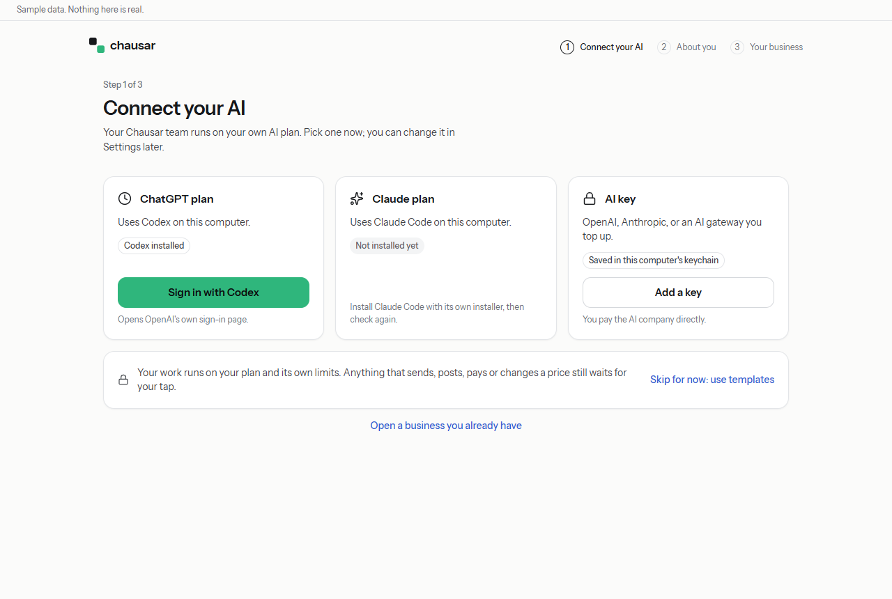
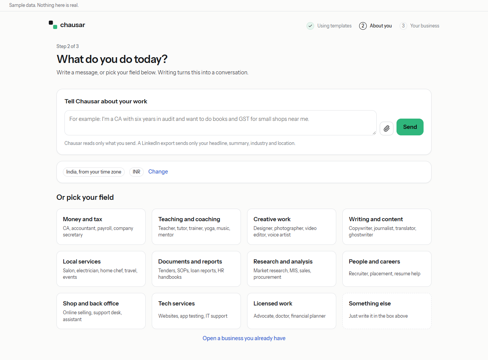
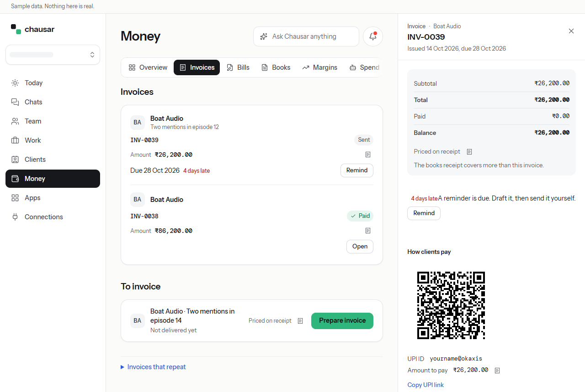
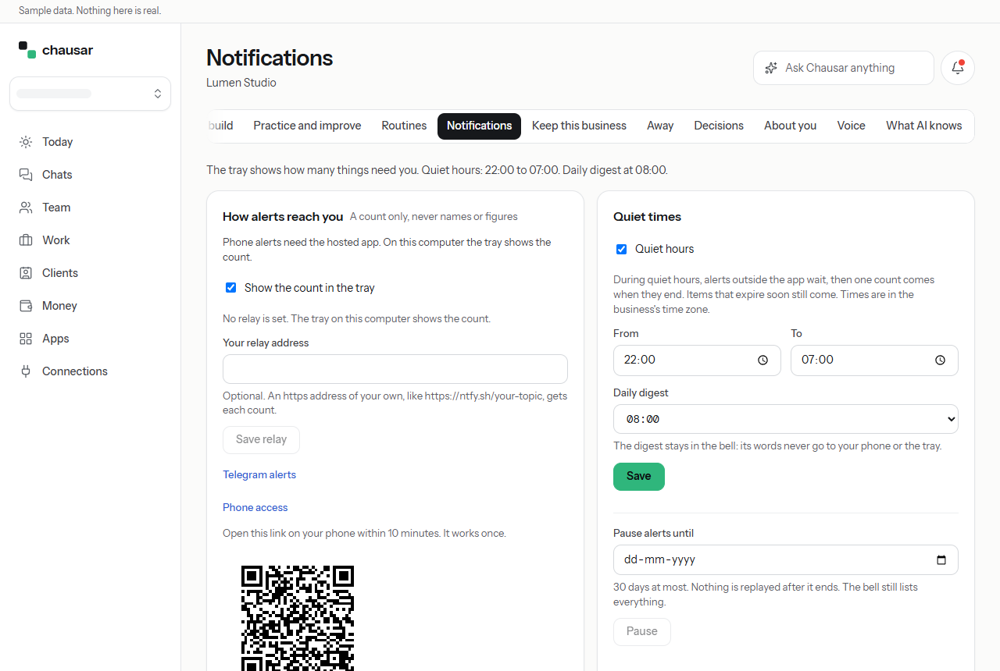

# Chausar beta guide

Chausar helps you run a small service business from your laptop. Your own AI does the work. You approve anything that leaves your computer.

This guide walks you through the first day. Each part is short. Words in **bold** are the exact words you see in the app.

This is a beta. Some parts are marked "coming later". They are not ready yet, so please don't rely on them.

## Contents

1. [Install Chausar](#1-install-chausar)
2. [Connect your AI](#2-connect-your-ai)
3. [Your first business](#3-your-first-business)
4. [Your first client and order](#4-your-first-client-and-order)
5. [Getting paid](#5-getting-paid)
6. [Phone access](#6-phone-access)
7. [Telegram alerts](#7-telegram-alerts)
8. [Sending a report](#8-sending-a-report)
9. [What Chausar never does](#9-what-chausar-never-does)
10. [Where to get help](#10-where-to-get-help)

How to move around: the list on the left has **Today**, **Chats**, **Team**, **Work**, **Clients**, **Money**, **Apps** and **Connections**. Your business's own pages (prices, notifications and more) open from your business name at the top left.

---

## 1. Install Chausar

Chausar is free. It runs on Windows and Linux laptops. There is no Mac version yet.

You need:

- a laptop with Windows 10 or 11, or a Linux laptop;
- an internet connection;
- a ChatGPT plan, a Claude plan, or an AI key (see part 2).

### Windows

1. Download the Windows file, `Chausar-Beta-0.1.0-preview.1-win-x64.exe` (about 300 MB). The number in the name changes with each beta.
2. Open it.
3. Windows may show a blue box: "Windows protected your PC". This is because the beta is not signed yet. It does not mean the file is harmful.
4. Click **More info**, then click **Run anyway**.
5. The installer installs Chausar for you only, so it does not ask for an admin password. It shows the folder it will use; you can change it. Click **Install**.
6. It adds Chausar to the Start menu and the desktop, and opens Chausar at the end.

Chausar starts when you sign in to Windows and waits in the system tray (the small icons near the clock, bottom right). Closing the window keeps it running there. Right-click the tray icon to see **Open Chausar**, the ticks **Start at login** and **Keep running in the tray** (untick either to switch it off), and **Quit Chausar and stop jobs**.

To remove Chausar: open Windows **Settings**, then **Apps**, find **Chausar** and click **Uninstall**. Your businesses stay on your laptop, in case you install it again.

### Linux

There are three Linux files. On Ubuntu, Debian or Linux Mint, use the `.deb`.

**The .deb (recommended)**

1. Download `Chausar-Beta-<version>-linux-amd64.deb`.
2. Open a terminal in the download folder and type `sudo apt install ./Chausar-Beta-*-linux-amd64.deb`. It asks for your password, because it installs Chausar for everyone on the computer.
3. Open Chausar from your apps menu, or type `chausar` in a terminal.

The .deb also sets up the sandbox that Chausar's window runs in. Ubuntu 24.04 and later block that sandbox unless the app installs a rule for it, and only the .deb can do that for you.

To remove it, type `sudo apt remove chausar`. Your businesses stay in `~/.config/Chausar`.

**The AppImage or the .tar.gz (other Linux)**

These suit Fedora, Arch and other systems without `apt`. They do not start on Ubuntu 24.04 or later, because they cannot install the sandbox rule; use the .deb there.

1. Download `Chausar-Beta-<version>-linux-x86_64.AppImage`.
2. Make it executable. Either:
   - right-click the file, open **Properties**, then **Permissions**, and tick "Allow executing file as program"; or
   - open a terminal in the download folder and type `chmod +x Chausar*.AppImage`.
3. Double-click the file to start Chausar.

If the AppImage says it needs FUSE, install the FUSE 2 library (often called `fuse2` or `fuse-libs`).

If you prefer the `.tar.gz` file: unpack it (`tar -xzf Chausar-Beta-*.tar.gz` in a terminal), open the folder and run `./chausar`. To remove it, delete the AppImage file or the folder.

On Linux, Chausar also starts when you sign in. To stop that, untick **Start at login** in the tray menu. Once Chausar is removed, your desktop skips that entry by itself.

---

## 2. Connect your AI

The first screen is **Connect your AI** (step 1 of 3). Your Chausar team runs on your own AI plan. Pick one of three tiles.

### ChatGPT plan (Codex)

1. The Windows installer includes Codex, so the tile says **Codex installed** even if you never installed it yourself. If you already have your own Codex, Chausar uses yours.
2. Click **Sign in with Codex**. OpenAI's own sign-in page opens.
3. Chausar shows a code under **Finish signing in on OpenAI's page**. Type that code on OpenAI's page. **Copy code** helps.
4. If the page did not open, click **Open the sign-in page again**.
5. Come back to Chausar. The tile now says **Signed in**.
6. Click **Use Codex**.

Already signed in to Codex? The tile says **Signed in** straight away. Just click **Use Codex**.

### Claude plan (Claude Code)

1. Install Claude Code with its own installer first. Until then the tile says **Not installed yet**.
2. Click **Sign in with Claude Code**. Anthropic's own sign-in page opens.
3. Finish there and come back. Then click **Use Claude Code**.

### AI key

Use this if you pay an AI company directly (OpenAI, Anthropic, or a gateway such as OpenRouter).

1. Click **Add a key**.
2. Pick the AI, paste your key, and read **What is sent**. Click **I agree**, then **Connect**.
3. You can set an optional monthly limit in US dollars. Calls stop when you reach it.
4. Click **Continue with this AI**.

The key is saved in your computer's keychain, not in Chausar's files.

### Good to know

- Chausar never sees your password or your login files. Sign-in always happens on OpenAI's or Anthropic's own page.
- Before you connect, the tile shows **What Chausar sends**. Read it once.
- No AI yet? Click **Skip for now: use templates**. You can connect later.
- To change your AI later: **Connections**, then **Your AI**, then **AI settings**.
- If work stops with a message about the model, open **AI settings** and pick a model your plan includes. Chausar never switches models on its own.

---

## 3. Your first business

### About you (step 2 of 3)

The screen asks **What do you do today?** You have two ways in.

**Write a message.** Type a few lines about your work in **Tell Chausar about your work**, then click **Send**. For example: "I'm a CA in Pune with six years in audit. I want to do monthly books and GST for small shops."

- You can attach your resume as a PDF, or your LinkedIn data export as a ZIP. Use the paper clip button. Chausar never takes a LinkedIn profile link. From the export it reads only your headline, summary, industry and location.
- After you send, the page turns into a chat on the left and **Your business** on the right.
- Reply in **Message Chausar** to change the plan. Or change the **Field** on the right.
- **Back to fields** takes you back to the tiles.

**Or pick your field.** Click one of the eleven tiles, such as **Money and tax** or **Teaching and coaching**. This goes straight to a plan.

Your country comes from your computer's time zone, for example **India, from your time zone**. Click **Change** if that is wrong. Prices are in rupees for India.

When the plan looks right, click **Keep this plan**.

Chausar then asks **Day job and rules**: whether you also have a job, and any rules your field sets for side work. Answer it before you go on; nothing is kept until you do.

Chausar may ask you for a passphrase (at least 12 characters; nobody can reset it). It may also show a **Recovery code**. Save the recovery code somewhere safe. You see it once, and it is the only way back in if you are locked out.

### Connect what your business needs (step 3 of 3)

Chausar lists the outside services your business may use, such as Gmail or TallyPrime. Each one says why.

- **Set up** opens that service's own sign-in or key steps.
- Items marked **Planned** are not ready yet. They say what to do meanwhile.
- Every item is optional. **Skip** any of them. They stay in **Connections** under **Services you need**.

Click **Go to Today** when you are done.

### Read and accept your plan

On **Today** you will see a few setup cards.

1. **Your plan is ready. Read it.** Click **Read**. **Accept** unlocks after you read it. Then click **Accept**.
2. **Keep this business**, if it shows. Click **Keep it** and save the recovery code.

### Set your prices

You set every price yourself. Chausar never picks a price for you.

1. On **Today**, find **Confirm your prices and tax** and click **Confirm**. (Or open your business name at the top left, then **Prices**.)
2. Each offer shows **Price not set**. Type your price in **New price for ..., in INR**.
3. Click **Save price**. A new price waits for you to accept it on **Today**.

For many professions in India there is a **Price ranges** fold under your offers. The small (i) button shows **Where this range comes from**, with the source and the date it was checked. Where no good source exists, it says **No reliable data**. A range is only a guide.

### Practice first, then go live

A new business starts in **Practice**. In Practice, drafts are marked as practice and never reach a client.

When you are ready for real clients:

1. Open your business name at the top left, then **Practice and improve**.
2. Under **Stage**, click **Go live**, then **Go live now**.

Live means **Live (you approve each)**: drafts can reach clients, each only after you approve it. You need an accepted plan and a connected AI to go live. **Back to practice** works any time.

---

## 4. Your first client and order

### Add the client

1. Open **Clients** and click **Add client**.
2. Type the **Name**. Only the name is needed. **Email** and **Note** are optional. **More details** holds a GSTIN or tax number.
3. Click **Add client**.

### Let your AI work with this client

Your AI cannot read a client's details until you allow it, once per client.

1. Open the client. Find **AI permission**. It says **Needed**.
2. Read the line under it. Click **Allow AI access**.

Only share what you have permission to share. You can withdraw this at any time. Withdrawing stops future sharing; it cannot take back what was already shared.

### Add the order

1. Open **Work** and click **New order**.
2. Choose the **Client** (or **New client**), the **Service**, and write **What they asked for**.
3. Add **Files from the client** if you have them (CSV, Excel, PDF, or a transcript; each under 1.5 MB).
4. Click **Add order**.

The order says **Received. Not started yet.** Click **Start** when you want the work to begin.

### Read the draft, then send it yourself

1. When the draft is ready, a card appears on **Today**. The order says **Draft ready. Read it before it goes to the client.**
2. Read it. You can **Edit** it, **Send back** with what to change, or **Approve** it.
3. After you approve: **Approved. Send it, then mark it delivered.** You send it to the client from your own email or WhatsApp.
4. Then click **Mark delivered** on the order.

---

## 5. Getting paid

### Make the invoice

After you mark an order delivered, its invoice waits on **Today**. You can also open **Money**, then **Invoices**, and click **Prepare invoice** under **To invoice**.

Check the draft and click **Issue** on **Today**. Every amount comes from Chausar's calculator. The small receipt mark next to an amount shows how it was worked out.

Need an advance or a part payment? On a draft invoice, open **Bill part of the order**, pick **Advance**, **Milestone** or **Part payment**, and click **Draft this part**. Later, **Bill the rest** makes the final invoice. The parts always add up to the order.

### Set up How to pay (once)

1. Open an invoice in **Money**, then **Invoices**.
2. Under **How clients pay**, click **Set up**.
3. Fill in what you use:
   - **UPI ID** (like yourname@okbank) and **Name clients see**;
   - bank details: **Account name**, **Account number**, **IFSC**, **Bank name**, and **SWIFT code, for clients abroad**;
   - **Days until an invoice is due** (7 days unless you change it);
   - **Payment terms on each invoice**;
   - **Reminder days late, with commas** (3, 10 and 30 unless you change them).
4. Click **Save**.

These settings work only on the computer, not from a phone.

### Send the invoice

Open the issued invoice. Under **How clients pay** you now see:

- a UPI QR code for the exact amount still owed;
- your **UPI ID** and the **Amount to pay**;
- **Copy UPI link**, a link you can send; it opens a UPI app with the amount filled in;
- your bank details.

Then use:

- **Save file** to save the invoice as a PDF;
- **Share on WhatsApp** or **Email it**. These open your own WhatsApp or mail app with a message ready. You attach the file and press send yourself. Chausar sends nothing.

### When the client pays

1. Open the invoice and click **Record payment**.
2. Type the **Amount received** and the date in **Received on**.
3. Under **How it was paid**, choose **UPI**, **Bank transfer**, **Cash** or another way.
4. Click **Record payment**.

A UPI payment shows as **marked paid by you**. Chausar does not check your bank; it records what you tell it.

Late payer? The invoice shows how late it is and a **Remind** button. Chausar drafts the reminder, and you send it yourself.

### Coming later

- **Razorpay payment links.** The setting is in **How clients pay**, but it is labelled **fixture-tested**: it has not run with a real Razorpay account yet. Use UPI and bank details for now.
- **Billing a client abroad in their own currency from the New order form.** For now the form has no currency fields. A foreign invoice shows no UPI (UPI takes rupees only); it shows your bank details with the SWIFT code instead.

---

## 6. Phone access

Chausar runs on your laptop. Your phone can open it in the phone's browser:

- **at home**, on the same Wi-Fi, with a pairing link;
- **away from home**, through Tailscale, a free app that links your own devices.

In short: open your business name at the top left, then **Notifications**. Under **How alerts reach you**, open **Phone access** and click **Make a pairing link**. Scan the QR code with your phone. The link works once, within 10 minutes.

Some things work only on the laptop itself: connecting or changing your AI, writing a new plan, billing and payment settings, and the phone and Telegram settings. The phone shows **Approve this inside the Chausar app.** for those.

Your laptop must be on, and Chausar running, for the phone to reach it.

The full steps, including Tailscale, are in [Phone access and phone alerts](venture/phone-access.md).

This has been tested on one computer only. It has not yet been tried with a real phone on home Wi-Fi or Tailscale.

---

## 7. Telegram alerts

Your own Telegram bot can tell your phone when something waits for you. It is free.

1. In Telegram, open **@BotFather**, send `/newbot`, and follow its steps. It gives you a bot token. Keep it private.
2. Open your new bot and press **Start**.
3. Find your chat id. The steps are in [Phone access and phone alerts](venture/phone-access.md#telegram-alerts).
4. In Chausar, open your business name, then **Notifications**. Open **Telegram alerts**.
5. Paste the **Bot token** and **Your chat id**, then click **Save bot**.
6. Click **Send a test alert**.

An alert says only how many things wait, like "Chausar: 3 things wait for you. Open the app to decide." **Add titles to alerts** adds the titles too. Titles can name clients, so leave it off if that matters.

An alert has no buttons and no links. You never approve anything in Telegram.

---

## 8. Sending a report

You can help us improve Chausar by sending a report. It is your choice, and it is off until you turn it on.

1. Open the business menu and choose **Reports**.
2. Tick **Usage reports**, **Crash reports**, or both, then click **Turn on reports**.
3. Under **What Send report sends** you see exactly what the report holds before anything leaves your computer.
4. Click **Send report**.

A report never holds client names, client data, message text, files or prompts, and earnings only ever go as a range. To stop, untick the boxes. To ask for your reports to be deleted, click **Delete my reports**, then **Yes, delete my reports**. That turns reports off and asks the Chausar team to delete what was sent; the team deletes it by hand.

---

## 9. What Chausar never does

- **No trades.** Chausar never places a trade of any kind, never gives stock tips or target prices, and never promises returns.
- **No sends without your approval.** Nothing that sends, posts, pays, issues an invoice, changes a price or deletes happens until you tap that exact item. A spoken "yes" never counts; you tap the card.
- **No LinkedIn scraping or automation.** Chausar never reads LinkedIn profiles or messages anyone on LinkedIn. For LinkedIn it only drafts text that you copy and send yourself.
- **Approvals stay in the app.** Telegram alerts and other phone alerts only tell you something waits. You approve inside Chausar.
- **No made-up numbers.** Every amount comes from the calculator with a receipt, or is labelled "model estimate".
- **No price picking.** You set every price.
- **No reading your sign-ins.** Chausar never shows its own ChatGPT or Claude sign-in and never reads your login files.
- **No client data to the AI without permission**, given once per client and withdrawable.
- **No tricks.** No fake reviews, no getting around CAPTCHAs or site rules, and no hidden AI voices.

---

## 10. Where to get help

- **Ask Chausar anything**, at the top of every page, answers questions about your own business.
- **Sending a report** (part 8) tells us what went wrong without sharing client data.
- **Write to us** at info@chausar.co.in. Say what you were doing and what you saw; never send passwords, keys or client details.

If something in this guide does not match what you see, please tell us. The app changes often during the beta.
