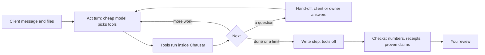

# Venture launcher: the delivery harness

Until this build a delivery agent made one model call: it read the client's message and drafted a reply. It had no tools, no loop, no sandbox and no way to get better. This page describes what replaced that: agents that use tools in a bounded loop, agent-written code in a sandbox, real work products with receipts, and a gated loop that improves the playbook one tested change at a time.

The two rules still hold everywhere. The AI never does arithmetic on money: every amount comes from code that writes a receipt, and the draft can only point at a receipt figure. And Chausar never fakes a capability: each tier and tool says plainly whether it runs on this computer today.

## How a run works

1. **Act turns.** The agent (the AI the owner connected for quick work, such as Claude Haiku 5.5) reads the client's message, the list of files, a short dictionary manifest and the tools it may use. Each turn it calls up to four tools, or none. Tool input is JSON text; every tool answers with the agentOS envelope, `{ok: true, result}` or `{ok: false, error: {code, name, message}}`.
2. **Tools run here.** Reading a file, the calculator, the sandbox and the dictionary all run inside Chausar. Nothing leaves the computer between turns. On the hosted server they run inside the business's engine there, without the sandbox, containers or PDF reading ([On the hosted server](#on-the-hosted-server)).
3. **Hand-offs end the turn.** When the agent needs something only the client or the owner knows, it calls `handoff.client` or `handoff.owner`. The turn stops (later calls in the same turn are cancelled) and the run waits for the answer. A question is words only: one with an amount in it is refused and the agent asks again. Its notes are words only too, apart from the short names below.
4. **The write step.** When the agent says it is finished, or a limit is reached, the AI for plans and drafts (such as Claude Sonnet 5.5) writes the reply with tools switched off. It gets a list of what the tools proved, in words, and the figure refs of every receipt. When a limit stopped the agent, this is the forced last step: it must say what was found and what is left.
5. **Checks.** The usual checks run, with two changes: a claim of finished work passes only when a tool run proves it, and a reply that reports proven work uses the report headings.

### Limits

| Limit | Default | What happens |
|---|---|---|
| Act turns | 4 | The write step is forced: "The agent used all its turns." |
| Tool calls per run | 12 | Further calls are cancelled with `HARNESS_LIMIT`, then the write step is forced |
| Tool calls per turn | 4 | A turn with more is refused as a whole |
| Spend per run | USD 0.25 | The write step is forced: "The run reached its spending limit." The monthly limit still applies on top |
| Results kept whole | 6 | Older tool results shrink to a 600 character stub, so each turn costs about the same |

The improvement loop can change the turn limit to one of 2, 3, 4, 5, 6 or 8, which also sets the tool calls to three per turn; nothing else changes the limits.

### Rehearsal and real orders

**Rehearsal** drives the loop on its own, under standing consent, because practice clients and their files are made up by Chausar. Bookkeeping's clean and messy practice clients each send a bank statement and a bill list (see `harness/practice.ts`). The practice client answers hand-offs while the scenario's turns allow, then says to go ahead. A practice client with no files gets the one-step draft, as before.

**A real order** with files runs the same loop, but every model turn holds client data, so every turn waits for the owner's approval of its exact text, exactly like a single draft did before. `venture.delivery.run` previews the first turn; each `venture.delivery.approve` sends one approved turn, runs its tools here, and previews the next. A hand-off moves the run to `needs-answer`; `venture.delivery.answer` takes the owner's answer (their decision, or what the client said) and previews the next turn. Moving the launch stage down stops the next send, as it always has. An order with no files, or a business with templates on the main tier, works as before.

When no AI serves quick work, the agent can't take tool turns: the run goes straight to the write step and says so ("No AI serves quick work, so the agent could not use its tools.").

### On the hosted server

The experimental hosted web server ([hosted.md](hosted.md#delivery-agents-on-the-hosted-server)) runs the same loop, with one rule: no agent tool there starts a process. So on `hosted-web`:

- row programs (`sandbox.transform`), Python in a container (`sandbox.python`) and bills picked from PDFs (`bills.pick`) are refused with `TIER_UNAVAILABLE` and a plain reason, before their input is read, and the agent is not offered them (no row language either);
- PDF text is never read, because the Python helper never runs on a shared server, and a PDF is refused when it is added;
- nothing checks for Docker, not even the capability list.

Agent-written code stays off there until the founder decides whether it may run on a shared server. Bookkeeping still works from CSV and XLSX: the reconciliation needs no sandbox, only the agent's own match keys go. A playbook's grant never changes with the host; the host decides only what is offered and what runs.

## Tools

Deny by default. A playbook step names the tools it may call, and a run may call only the tools its playbook's agent steps hold. Anything else returns `TOOL_DENIED`. The writing step never holds tools, code steps never hold tools, and no step may hold an outside write.

| Tool | Does | Effect | Tier | Bookkeeping playbook |
|---|---|---|---|---|
| `files.list` | Lists the files and the tables in them, with columns | read | code | gather |
| `files.read` | Reads a table (columns, a sample, or rows sixty at a time) or a PDF's text, with amounts and dates to pick by id | read | code | gather, work |
| `dictionary.browse` | Searches the business dictionary with a few words | read | code | gather |
| `dictionary.resolve` | Checks up to five words against the dictionary | read | code | gather, clarify |
| `calc.sum` | The calculator adds one amount column, all rows or where a column equals a value | compute | code | work |
| `calc.totals` | The calculator totals an amount column by group | compute | code | work |
| `books.reconcile` | Reconciles a bank statement against bill tables | compute | code | work |
| `bills.pick` | Makes a bill table from PDF bills: the agent picks each total by its amount id | compute | code | work |
| `sandbox.transform` | Runs the agent's row program over a table in the light sandbox | sandbox | wasm-lite | work |
| `sandbox.python` | Runs the agent's Python `transform(row)` in a Docker container | sandbox | container | work |
| `handoff.client`, `handoff.owner` | Asks one question and ends the turn | handoff | code | gather, clarify, work |
| `outbox.propose` | Records an outside action for the owner to approve; sends nothing | outside-write | code | never granted |

Other service types get the same tools except `books.reconcile` and `bills.pick`.

The model addresses things by short names: `f1` is the first file, `f1.s2` its second sheet, `t1` the first table a tool made, `w1` the first work receipt. Tool input is checked field by field: an unknown field, a wrong choice or text that is too long is refused with `TOOL_INPUT_INVALID` and the agent sees why. A call has sixty seconds. A table or receipt joins the run only when its call finished in time, so a slow call that finishes late can't shift the short names.

### Client files

`venture.files.add { orderId, name, contentBase64 }` (in the app only) keeps one file in the vault as client data: CSV (UTF-8), XLSX, or PDF, at most 1.45 MB so it fits one desktop request, at most ten per order. On the hosted server a request is at most 256 KB, so a file there can be at most about 190 KB, and a PDF is refused. The format is checked against the content, and a CSV or XLSX that the tools could never read is refused before it is stored. The `upload-added` event never carries the file name. A run fixes its list of files when it starts.

CSV and XLSX are read by code in this process (`harness/files.ts`, using the existing workbook reader). Blank or repeated headers get names (`Column 2`, `Date (2)`) instead of failing. PDF text comes from the trusted Python helper's `pdf.extract`; without Python and pdfplumber the tool says so and nothing is guessed. Scanned pages need an OCR reader this build does not have.

### The business dictionary

The dictionary is searched through tools, not pasted into prompts (EvoOntology found pasting a semantic layer made a strong model worse, and tool access made every model better). Entries come from the business's own records: its terms, its offers (no prices), its delivery steps and approvals, its tax and currency settings, the owner's published money definitions, and a short glossary for the service type. Ranking is plain word overlap with a phrase bonus. Prompts carry only a manifest of under four hundred characters. The improvement loop can teach an entry an extra word (`alias.add`).

## Work products and receipts

The calculator for agent work (`harness/work.ts`) reads every amount from the client's file with exact decimal parsing (commas in Indian or Western grouping, the business's own currency code or sign, brackets or Dr and Cr) and adds with BigInt. A cell it can't read exactly is refused with its row, never guessed; an amount marked in another currency is refused, never read as the business's own. The agent picks tables and columns by name; it never types an amount.

Amounts come only from the client's files and from bills picked out of PDFs by amount id. A table a program made holds labels and keys, so the calculator refuses to read amounts from it. A table joined to another by row id (groups for totals, match keys for a reconciliation) must have been made from that table by a program.

Each answer is a **work receipt** (`venture-work-receipt`): the tables it read with their digests, the columns, the row ids, every step with its inputs and result, the figures, the numbers a sentence may cite, an explanation built by code, and a digest. `venture.work.get { id }` returns one.

**A reconciled month** is bookkeeping's work product. `books.reconcile`:

- reads the statement oldest first: the dates decide which way it runs when every row has one, else the running balance does (the order with fewer breaks), so one bad balance can't swap the opening and the closing;
- checks the running balance row by row;
- works out the opening balance, money in, money out and the closing balance, and compares it with the statement's own closing balance;
- matches money out to bills in four passes: the agent's own keys (from a row program), a bill number found in the bank text, the same amount and the supplier's name, then the same amount when it is unique on both sides; among bills that fit, a payment takes the oldest one dated on or before it;
- lists payments with no bill, bills not paid in the statement, and money in.

A statement with no balance column is never called balanced: the receipt says the closing balance could not be checked.

The draft cites work figures as figure parts (`w1.statement-closing`, `w1.matched-count`) exactly as it cites prices. Code then attaches the reconciliation itself after the agent's words, rendered from the receipt: the figures, whether the statement balances, the matches and the gaps, each amount with its receipt. The judge sees only whether it balances and whether there are gaps, never an amount.

## Agent-written code: tiers, labelled honestly

| Tier | What runs | State on this build |
|---|---|---|
| Code | The calculator, the checks, the agent loop | Available. Not a sandbox |
| Agent turns | Model calls that pick tools | Available. Not a sandbox |
| Light sandbox (`wasm-lite`) | The agent's row programs, compiled to WebAssembly | Available on the desktop and in local web mode, Windows included. Off on the hosted server |
| Full sandbox (`wasm`) | agentOS virtual machines | Unavailable on Windows; planned elsewhere |
| Containers | The agent's Python in Docker | Only where Docker Desktop and the image are set up; then "not yet tried on a real task". Never on the hosted server |
| Hosted sandboxes | E2B, Sail or Cloudflare on the owner's account | Planned |

**The light sandbox.** Agents write a small row language: one statement per line, `let name = ...` or `out name = ...`, with text functions (`lower`, `trim`, `before`, `after`, `replace`, `concat`), yes or no tests (`contains`, `starts`, `ends`, `equals`, `empty`, with `and`, `or`, `not`) and `if ... then ... else`. It has no numbers and no loops, so it can't add up money and it always finishes. Chausar checks the program, compiles it to a WebAssembly module with hand-written string helpers (`harness/sandbox-wasm.ts`, no outside compiler), and runs it in the same isolated worker as back office plugins (`platform/runtime/wasm-worker.mjs`, now with a table mode): a separate Node process that can read only the worker file, with a memory cap and a time limit. The module imports nothing. Large tables run in chunks. Every value a program makes is checked as a label or a key: `INV-0042` passes; `4500`, `2026-09-14` and `INR4500` are refused.

**Containers.** `sandbox.python` runs the agent's `transform(row)` in `python:3.12-alpine` with no network, a read-only root, every capability dropped, a memory cap of 256 MB and 64 processes at most. The code goes in on standard input, never on the command line. Before anything runs, Chausar checks that Docker answers and the image is already on the computer, and the run itself says `--pull=never`: it never downloads an image. The check is reused for a minute so the capability list doesn't start Docker on every screen. On this Windows machine Docker is absent, so the row says "Needs Docker Desktop." Tests drive the container tier through an injected port; it has not been run against a real Docker yet.

## When a draft may say work was done

A done claim needs a tool run of the matching kind in the same run:

| The draft says | Needs a proof of |
|---|---|
| matched | a reconciliation that matched at least one payment |
| reconciled | a reconciliation that checked the closing balance |
| closed, verified | a statement that balances |
| sorted, tidied, cleaned | a row program run (sorted also accepts totals) |
| reviewed, checked, analysed | a file read |
| prepared, completed, finished | a row program run, totals or a reconciliation |
| sent, filed, posted, submitted, uploaded, fixed | never: this build does no outside writes |

Without any proof the old rule stands: the agent only had the client's message, so any done claim fails. The judge gets the same list of proven work, in words, and answers `no-unbacked-claims` against it.

## The improvement loop

`venture.improve.run { maxRounds?, useTemplate? }` follows Harness Learning and EvoOntology:

1. **Freeze.** The business's signals (rejected drafts, edited drafts, failed checks) are sorted by time. The latest thirty percent, at least one once there are two, are held back as the reserve; only the gate sees them, and their rehearsal results never reach the diagnosis in any round. The rest is the pool.
2. **Diagnose.** Reasons from the pool and the latest rehearsal failures are counted into clusters.
3. **Attribute.** Each reason points at one level: `harness` (guidance or checks on a step), `tools` (grants, dictionary words, the turn limit), `dictionary` or `calculator`. A wrong number or a price with no receipt points at the calculator's inputs and a wrong fact at the dictionary; neither is ever fixed in a prompt, so those reasons get no patch.
4. **Patch.** One typed change with a change note: `guidance.add`, `guidance.remove`, `tools.grant`, `tools.revoke`, `checks.add`, `limits.turns` or `alias.add`. When an AI serves plans it proposes the change from reason codes, counts and the playbook only (no client data). Chausar's own rule for the reason is the fallback.
5. **Check before spending.** Code refuses a patch that does not apply, names a missing step, tool, check or entry, grants a tool the service type may not hold or any outside write, picks a turn limit off the list, holds a number, or asks the agent to do sums.
6. **Gate.** The old and the new playbook rehearse the reserve cases plus the three practice clients. Each case goes to whichever version did better: no critical error (a number, a receipt, an outside write or an unbacked claim), then passing, then more checks passed, then more judge yeses. The new version is kept only with no new critical error, no case the old one passed and the new one fails, and more wins than losses.
7. **Keep the winner.** Rounds build on the version kept so far (two by default, four at most). A kept candidate is stored as a new playbook version with its parent and its patch chain; the parent is never changed. Its rehearsal of the three practice clients is stored too, so it counts once adopted.
8. **Adopt.** `venture.improve.status` shows a kept candidate in plain words; `venture.improve.adopt { runId, digest }` (in the app only) points the business at it. A candidate goes stale when the playbook or the plan changed since the run (`CANDIDATE_STALE`). A plan change rebuilds the playbook and carries the adopted patches over when they still apply.

Without an AI both versions write the same template outlines, so the gate keeps the old version and says why. The readiness reminder on the launch ladder never runs the loop on its own.

## New methods

| Method | Who | What |
|---|---|---|
| `venture.files.add` | app only | Adds one client file to an order |
| `venture.files.list` | read | Files, without their content |
| `venture.delivery.answer` | app only | Answers the agent's hand-off on a real order |
| `venture.work.get` | read | One work receipt |
| `venture.improve.status` | read | Readiness, the version in use, the latest run, a candidate waiting |
| `venture.improve.run` | prepare | One improvement run |
| `venture.improve.get` | read | One improvement run |
| `venture.improve.adopt` | app only | Switches to a kept candidate |

New record kinds: `venture-upload`, `venture-work-table`, `venture-work-receipt`, `venture-improvement-run`. New model purposes: `agent-turn` (quick tier) and `improve` (main tier). A delivery run has a `needs-answer` status.

## Files

| File | What it does |
|---|---|
| `delivery/harness/loop.ts` | The loop: turns, limits, compaction, hand-offs, the forced write step, proven sentences |
| `delivery/harness/tools.ts` | The tools, their fields, envelopes and the deny-by-default check |
| `delivery/harness/files.ts`, `cells.ts`, `practice.ts` | Client files, reading amounts and dates, practice files |
| `delivery/harness/work.ts`, `work-get.ts` | The calculator for agent work and the reconciliation |
| `delivery/harness/dictionary.ts` | The business dictionary |
| `delivery/harness/sandbox-lang.ts`, `sandbox-wasm.ts`, `sandbox.ts` | The row language, its WebAssembly compiler, the tiers |
| `delivery/harness/claims.ts`, `patches.ts`, `env.ts` | Proven claims, typed patches, a run's tool environment |
| `delivery/improve.ts` | The improvement loop |

Tests: `platform/tests/venture-harness.test.ts` and `venture-harness-runs.test.ts`. The end-to-end journey's replay fixture now has the agent's turns for the clean and messy practice months, so the journey reads the files, reconciles both months, asks the practice client one question and writes two reports.

## How it was checked

On Windows with Node 24.13.1, with no network and no paid call:

- `node scripts/check.mjs` and a typecheck of the whole project with `typescript@5.9.3` against the repo `tsconfig.json`: both clean.
- `venture-harness.test.ts` and `venture-harness-runs.test.ts`: 36 of 36. They cover the row language against a reference interpreter, the worker over 900 rows, the container tier through a scripted Docker port, reading cells, both practice months reconciled, the tools' refusals, the loop's limits and hand-offs, claims, a real order run turn by turn, the patches, the gate and two improvement runs end to end.
- The end-to-end journey now rehearses both practice months with the agent loop through the real engine and model port, answering from the synthetic recording.
- An independent review of the new code found an amount laundering path (agent code gluing a currency code to a number, then the calculator adding it), a statement-direction mistake, a late-finishing tool shifting short names, held-back cases reaching the proposer from round two, and smaller issues. Each was fixed and has a test.
- After the delivery harness was merged in (branch `b2c/integrate`): `node scripts/check.mjs` (504 files) and the full typecheck, both clean; every `venture-*.test.ts` and `hosted-*.test.ts` file run one after another, 315 tests, 307 pass, 0 fail, 8 skipped (the real PostgreSQL tests); and the parity and shell files (`desktop-harness`, `desktop-ipc-methods`, `desktop-renderer`, `desktop-main`, `desktop-packaging`, `server`), 57 of 57. New tests check that on a hosted host nothing checks for Docker, row programs, Python, containers and PDFs are refused with `TIER_UNAVAILABLE` and not offered, the capability rows use the same words, and a real bookkeeping order reconciles from CSV. Removing any one of those guards on purpose fails at least one of them. The whole suite was not run after the merge.
- One serial full run, `node --test --test-concurrency=1 platform/tests/*.test.ts`, with nothing else running: 2,763 tests, 2,762 pass, 0 fail, 1 skipped (the DuckDB proof that needs the native module, skipped before this work too), in about 25 minutes.

## Screens

The renderer (`app/renderer/launch.js`) shows the harness in the places the owner already uses. Screenshots 30 to 37 in [`screens/`](screens/) show each one in light and dark, at 1280 px and at 375 px.

- **Clients.** An opened order lists its files, one line each with the format, and "Add a file" opens the computer's own file chooser (CSV, XLSX or PDF). The screen refuses a file over 1.45 MB before any request, then sends the file as base64 in one `venture.files.add`; the engine checks the format against the content, and its words appear where the file was added. At ten files the link gives way to "Ten files, the most an order holds." The line under the files says "Files stay in your vault. Parts the agent reads go to your AI only in a turn you approve."
- **The draft sheet while the agent works.** A line says which turn it is ("Turn 2 of 4"), with one mark per turn the run may take: done, this one, the rest. "What the agent did" sits open above the text to approve and lists each turn: the agent's own note, then each tool call in plain words read from `run.harness` ("Listed the files", "Read bank-september.csv", "Reconciled bank-september.csv with the bills"), with the engine's message when a call failed or was skipped and a Receipt link on a call that made a work receipt. The short names the agent used (`f1`, `f1.s2`) show as the file's own name. The exact text of the next turn follows, with "Approve and send" behind the same box as before; an act turn adds "Tools run on this computer between turns. Nothing reaches the client." The write step reads "Last step: the report", with the engine's reason when a limit forced it.
- **The agent's question.** A run in `needs-answer` shows "The agent asks you" (or "The agent asks the client", with "Ask the client, then write what they said.") above the question and a box for the answer. "Send answer" calls `venture.delivery.answer` with the words as typed, and the next turn then shows its exact text first. An answered question stays with its turn, with the answer under it.
- **The report.** A ready report shows the agent's words exactly, then the reconciliation once, drawn from its work receipt (`venture.work.get`): whether the statement balances, one mark per payment or bill (green matched, amber a payment with no bill, open a bill not paid), the three counts with each match and gap under its count, and "Work receipt", which opens every money figure, how it was worked out, the files it read and the receipt id. The box of report text stops where the code-printed reconciliation begins, so it shows once; Copy and Save still take the whole report. "What the agent did" folds under the report.
- **Agents.** One folded line at rest says whether improvement is due: "Improvement: not due yet", "ready to run" or "a change to adopt". Inside: the engine's reason, how many drafts were reviewed, the last run (what it kept, the gate's reason, its cost, and one mark per case: won, tied, lost), a kept change in the engine's own words with "Adopt this version" (`venture.improve.adopt` with the run's digest), and "Run the improvement loop" (a quiet link while a change waits). A stale change shows the engine's reason. "How agents work" names the playbook version in use.
- **Today.** "A question to answer" and "A playbook change to review" join what awaits the owner.

No screen does money arithmetic: every amount is an engine display string, and the marks are counts.

## Upgrading a business made before the harness

A playbook stored before this build has no harness format, so the first call rebuilds it as a new version with the tools and limits above. Rehearsals of the old version no longer count for the new one: rehearse the three practice clients again before moving up the ladder. Real orders in flight keep the playbook they started with.

## What is not built, or not checked

- **One approval per turn.** A real order with files needs the owner to approve each model turn (a typical month takes three to five). Approving a whole run once, within stated files, tools and spend, would change the consent rule and is a decision for the founder.
- **Screens** were checked by the renderer tests and on a scratch page in headless Chrome, against the fixtures and against real engine output from a scripted model port. They have not run in the Electron window or with a live model. Rehearsal rows on Agents do not show the agent's turns in a practice month yet, and an improvement run's hypothesis and per-case scores stay in its record.
- **Containers** have run only against a scripted Docker port in tests.
- **Agent-written code and PDFs on the hosted server.** Row programs, containers and the Python helper are refused there until the founder decides whether agent-written code may run on a shared server.
- **PDF bills** need the Python helper with pdfplumber; scans need OCR, which this build lacks.
- **Work products** exist for bookkeeping only. Other service types use files and tools but still reply with a plan.
- **Inboxes, the web and outside writes** are not tools.
- **The improvement loop** has small held-back sets in a new business, so a kept change is modest evidence; it learns more as reviewed drafts pile up. The proposer is an untrained model or Chausar's rule table.
- **The client data guard.** Real-order turns are always flagged as holding client data, so they always wait for approval. The second guard, which scans the exact text sent under standing consent, looks for client names, emails, order requests and edited drafts; it does not scan uploaded file contents, because windowing whole files on every call is too costly. Rehearsal only ever sends Chausar's practice files.
- **No live model call** was made: every model answer in tests and the demo is a synthetic recording.
